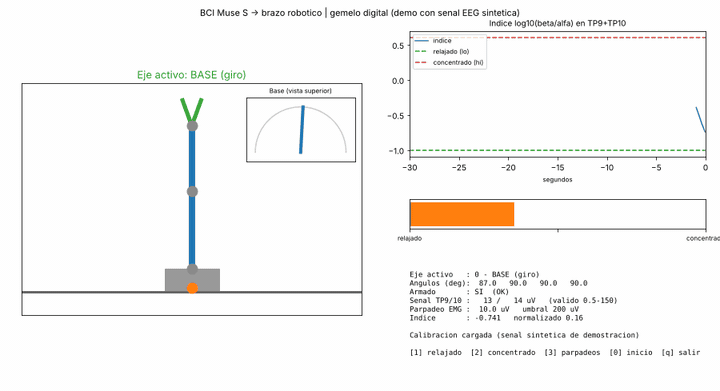
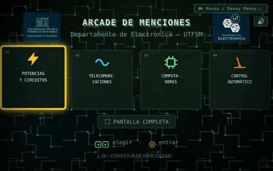
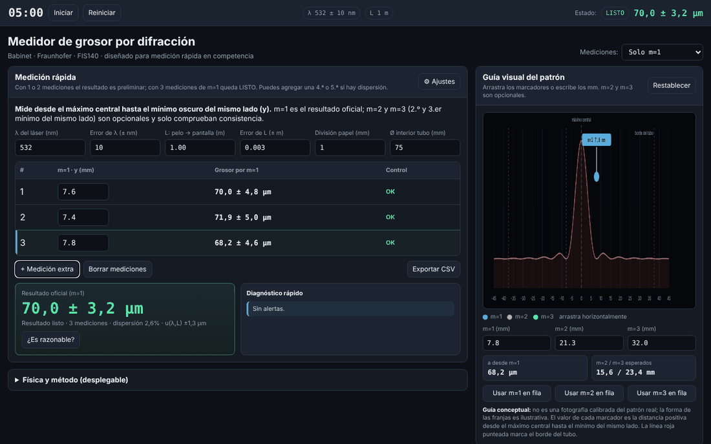
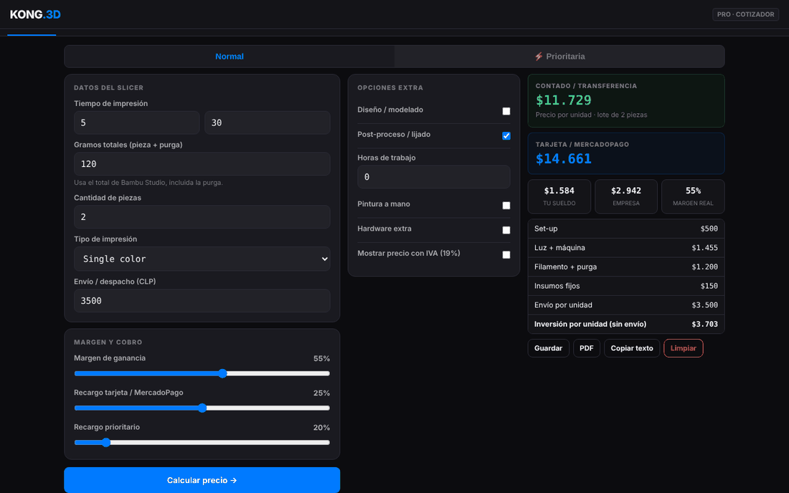
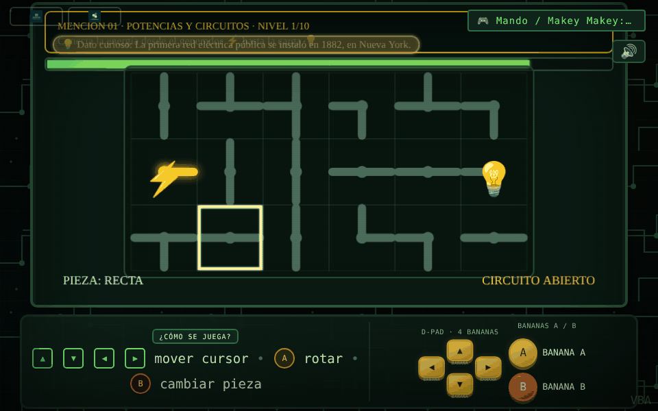
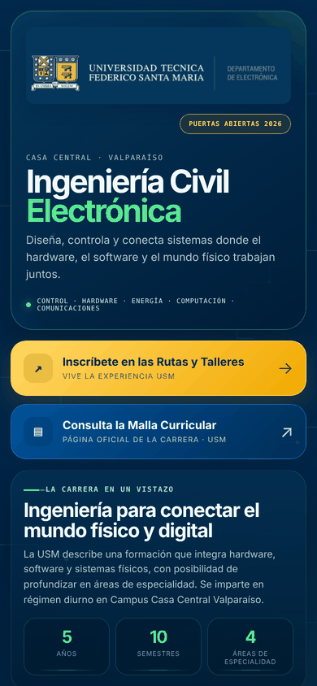
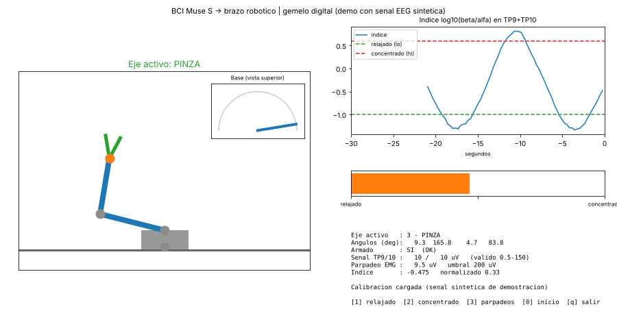

# Vicente Bohle Alveal — Portafolio de electrónica y software

Estudiante de Ingeniería Civil Electrónica en la Universidad Técnica Federico Santa María (UTFSM, Chile). Aquí reúno proyectos seleccionados de sistemas embebidos, interfaces cerebro-computador, visión por computador y herramientas web para ingeniería.

**[▶ Abrir el portafolio en vivo](https://vicentebohlealveal.github.io/vicente-bohle-software-portfolio/)** · [LinkedIn](https://www.linkedin.com/in/vicente-bohle-alveal-b38317203/) · [English version](README.md)

---

## Proyectos destacados

### Interfaz cerebro-computador (BCI) asistiva para un brazo robótico
La señal EEG de una diadema Muse S se procesa en Python y controla, mediante un ESP32 por UDP, un brazo robótico de 3 ejes con pinza. Un parpadeo voluntario funciona como embrague para cambiar de eje, la relación de potencia beta/alfa define el ángulo y una capa de seguridad desarma el brazo si la señal es mala o la cabeza se mueve. Un gemelo digital muestra el brazo en tiempo real.

*El gemelo digital ejecutando el código real de procesamiento con EEG sintético (`demo_sintetica.py`), para probarlo sin la diadema.*

**Python · NumPy · SciPy · BrainFlow · Matplotlib · ESP32 · UDP** — [Código](projects/bci-brain-computer-interface-arm/) · [Repo propio](https://github.com/vicentebohlealveal/bci-eeg-robotic-arm)

### Arcade de Menciones
Arcade educativo autónomo para las actividades de difusión de la UTFSM. Cuatro minijuegos presentan cada mención de Ingeniería Civil Electrónica (potencia y circuitos, telecomunicaciones, computadores y control automático). Se juega tocando frutas conectadas a un Makey Makey. Se entregó a la universidad junto con un manual de operador.

**HTML · JavaScript · Canvas · Web Audio · Makey Makey** — [Jugar](https://vicentebohlealveal.github.io/vicente-bohle-software-portfolio/projects/arcade-menciones/) · [Código](projects/arcade-menciones/) · [Repo propio](https://github.com/vicentebohlealveal/arcade-menciones)

### Medidor de grosor de cabello por difracción láser
Herramienta de laboratorio hecha para la competencia de física FIS140. Mide el grosor de un cabello a partir del patrón de difracción de Fraunhofer de un láser, propaga la incertidumbre y avisa cuando las mediciones no son consistentes.

**HTML · JavaScript · óptica · análisis de incertidumbre** — [Abrir](https://vicentebohlealveal.github.io/vicente-bohle-software-portfolio/projects/medidor-grosor-cabello/) · [Código](projects/medidor-grosor-cabello/)

---

## Todos los proyectos

| Proyecto | Qué hace | Demo |
|---|---|---|
| [Interfaz cerebro-computador](projects/bci-brain-computer-interface-arm) | Control de un brazo robótico con EEG: embrague por parpadeo, acelerador beta/alfa, lógica de seguridad y gemelo digital | Ejecutar `demo_sintetica.py` |
| [Estación de carga solar](projects/solar-home-charging-automation) | Firmware ESP32 que programa la carga de baterías externas con relé, encoder y pantalla OLED | — |
| [Arcade de Menciones](projects/arcade-menciones) | Arcade educativo con cuatro minijuegos que se controlan con Makey Makey | [Jugar](https://vicentebohlealveal.github.io/vicente-bohle-software-portfolio/projects/arcade-menciones/) |
| [Contador agrícola de frutos](projects/lemon-fruit-detection) | Cuenta limones en vivo con la cámara usando un modelo YOLO propio que corre en el navegador (ONNX) | [Demo](https://luminous-bubblegum-27933a.netlify.app/) |
| [HandTrack Pro](projects/robotic-hand-control-ml) | Detecta la mano con la cámara (MediaPipe) y envía el estado de cada dedo por puerto serie a una mano robótica | [Abrir](https://vicentebohlealveal.github.io/vicente-bohle-software-portfolio/projects/robotic-hand-control-ml/) |
| [Medidor de grosor de cabello](projects/medidor-grosor-cabello) | Medición por difracción láser, calibración y análisis de incertidumbre | [Abrir](https://vicentebohlealveal.github.io/vicente-bohle-software-portfolio/projects/medidor-grosor-cabello/) |
| [Inventario de taller Kong.3d](projects/kong3d-inventario) | Organiza componentes por gaveta y compartimento, con buscador y sincronización entre teléfono y computador | [Demo](https://reliable-unicorn-74e1be.netlify.app/) |
| [Cotizador Kong.3D Pro](projects/3d-print-cost-calculator) | Calcula costos y precios de impresión 3D, con historial y exportación a PDF y CSV | [Abrir](https://vicentebohlealveal.github.io/vicente-bohle-software-portfolio/projects/3d-print-cost-calculator/) |
| [Portal de admisión UTFSM](projects/portal-admision-electronica-usm) | Página para celular a la que se llega con un código QR en las jornadas de puertas abiertas | [Demo](https://elegant-kringle-ac50f4.netlify.app/) |

Solo documentación (faltan los archivos originales): [plataforma robótica e IoT](projects/large-scale-robotic-platform-iot) · [cargador de vehículos eléctricos y UPS on-line](projects/ev-charger-and-ups).

  
  

  
  
  

**Notas:** el contador de frutos necesita su modelo entrenado `best.onnx`, que no está en este repositorio; la sincronización del inventario requiere configurar tu propio proyecto de Supabase.

## Historial de versiones

Las versiones antiguas de varios proyectos están en ramas aparte, un commit por cada versión guardada y con un resumen `VERSIONES.md`: [medidor de cabello](https://github.com/vicentebohlealveal/vicente-bohle-software-portfolio/blob/historial-medidor/VERSIONES.md) · [HandTrack Pro](https://github.com/vicentebohlealveal/vicente-bohle-software-portfolio/blob/historial-handtrack/VERSIONES.md) · [cotizador Kong.3D Pro](https://github.com/vicentebohlealveal/vicente-bohle-software-portfolio/blob/historial-calculadora/VERSIONES.md) · [inventario](https://github.com/vicentebohlealveal/vicente-bohle-software-portfolio/blob/historial-inventario/VERSIONES.md). La BCI, el Arcade y el contador de frutos tienen una rama `historial` en sus propios repositorios.

## Licencia

© 2026 Vicente Bohle Alveal. **Todos los derechos reservados.** Este repositorio es público para que se pueda revisar como portafolio. No se permite copiar, modificar, redistribuir ni reutilizar su contenido, total o parcialmente, sin autorización escrita del autor. Ver [LICENSE](LICENSE).

El manual del operador del Arcade de Menciones fue escrito por el autor y vendido a la UTFSM para uso institucional; se incluye con autorización y debe conservar su atribución. El portal de admisión usa la identidad gráfica de la UTFSM y se conserva solo como muestra de trabajo en su contexto autorizado.
