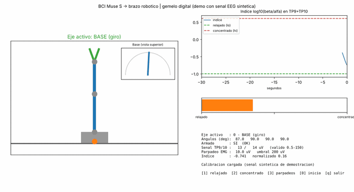
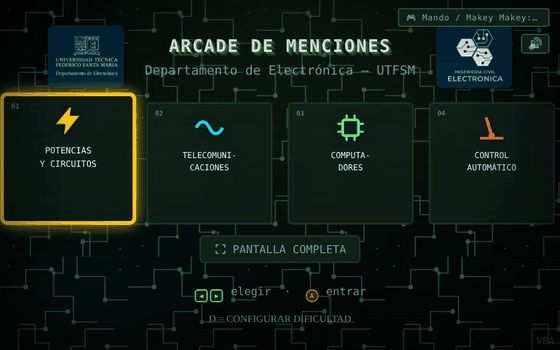
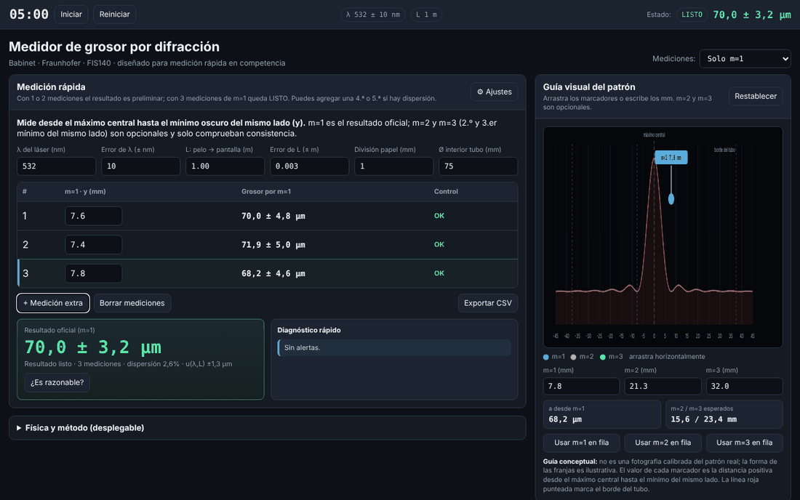
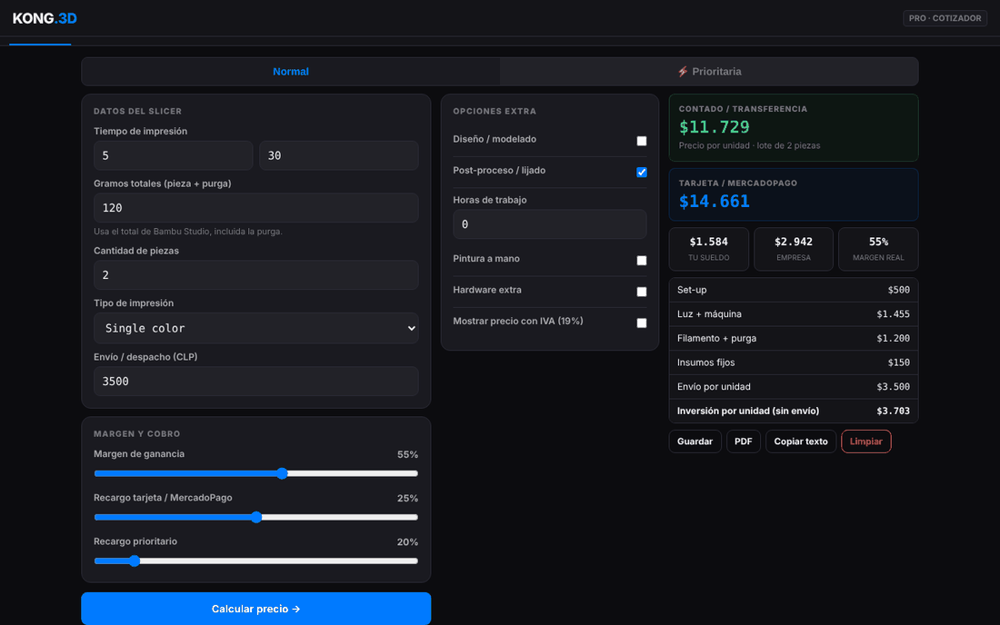
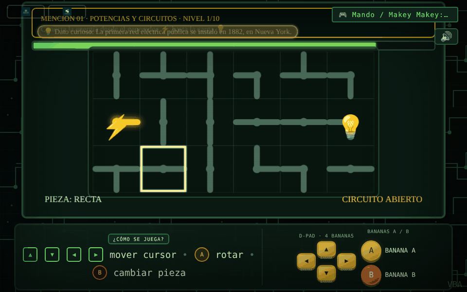
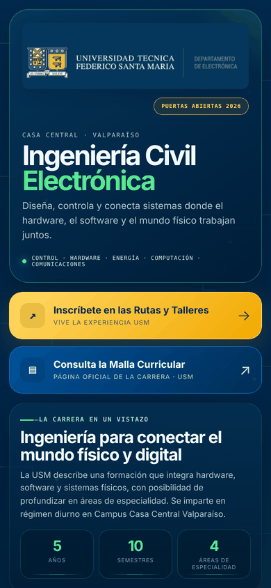
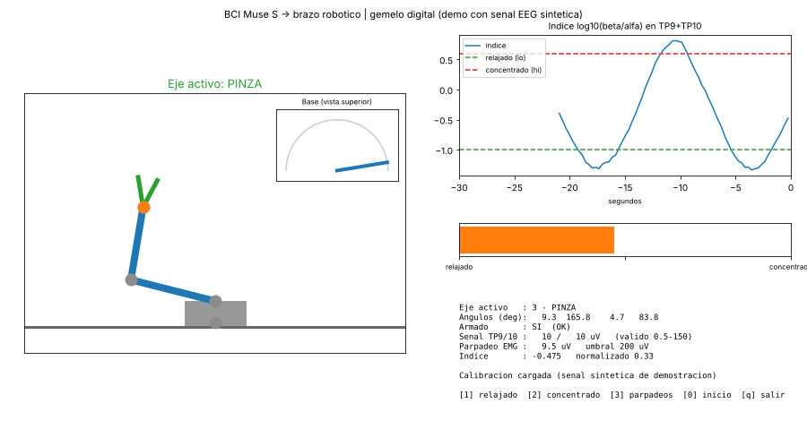

# Vicente Bohle Alveal — Electronics & Software Portfolio

Electronic Engineering student at Universidad Técnica Federico Santa María (UTFSM, Chile). These are selected projects in embedded systems, brain–computer interfaces, computer vision and browser-based engineering tools.

**[▶ Open the live portfolio](https://vicentebohlealveal.github.io/vicente-bohle-software-portfolio/)** · [LinkedIn](https://www.linkedin.com/in/vicente-bohle-alveal-b38317203/) · [Versión en español](README.es.md)

---

## Featured projects

### Assistive brain–computer interface for a robotic arm
EEG from a Muse S headband, processed in Python, controls a 3-axis robotic arm with a gripper through an ESP32 over UDP. A voluntary blink acts as a clutch that switches the active joint, the beta/alpha band-power ratio drives the joint angle, and a safety layer disarms the arm when the signal is poor or the head moves. A digital twin shows the arm in real time.

*The digital twin running the real processing code on synthetic EEG (`demo_sintetica.py`), so it can be tested without the headset.*

**Python · NumPy · SciPy · BrainFlow · Matplotlib · ESP32 · UDP** — [Code](projects/bci-brain-computer-interface-arm/) · [Standalone repo](https://github.com/vicentebohlealveal/bci-eeg-robotic-arm)

### Arcade de Menciones
A self-contained educational arcade for UTFSM outreach events. Four mini-games introduce each specialization of Electronic Engineering (power and circuits, telecommunications, computers, automatic control). Visitors play by touching fruit wired to a Makey Makey. Delivered to the university together with an operator manual.

**HTML · JavaScript · Canvas · Web Audio · Makey Makey** — [Live demo](https://vicentebohlealveal.github.io/vicente-bohle-software-portfolio/projects/arcade-menciones/) · [Code](projects/arcade-menciones/) · [Standalone repo](https://github.com/vicentebohlealveal/arcade-menciones)

### Hair-thickness meter (laser diffraction)
Lab tool built for the FIS140 physics competition. It measures hair thickness from the Fraunhofer diffraction pattern of a laser, propagates uncertainty and flags inconsistent measurements.

**HTML · JavaScript · optics · uncertainty analysis** — [Live demo](https://vicentebohlealveal.github.io/vicente-bohle-software-portfolio/projects/medidor-grosor-cabello/) · [Code](projects/medidor-grosor-cabello/)

---

## All projects

| Project | What it does | Demo |
|---|---|---|
| [Brain–computer interface](projects/bci-brain-computer-interface-arm) | EEG → robotic arm control with blink clutch, beta/alpha throttle, safety logic and digital twin | Run `demo_sintetica.py` |
| [Solar charging station](projects/solar-home-charging-automation) | ESP32 firmware that schedules battery-pack charging with a relay, rotary encoder and OLED | — |
| [Arcade de Menciones](projects/arcade-menciones) | Educational arcade with four mini-games controlled through Makey Makey | [Play](https://vicentebohlealveal.github.io/vicente-bohle-software-portfolio/projects/arcade-menciones/) |
| [Agricultural fruit counter](projects/lemon-fruit-detection) | Counts lemons live from the camera with a custom YOLO model running in the browser (ONNX) | [Demo](https://luminous-bubblegum-27933a.netlify.app/) |
| [HandTrack Pro](projects/robotic-hand-control-ml) | Tracks the hand with the camera (MediaPipe) and sends finger states over serial to a robotic hand | [Open](https://vicentebohlealveal.github.io/vicente-bohle-software-portfolio/projects/robotic-hand-control-ml/) |
| [Hair-thickness meter](projects/medidor-grosor-cabello) | Laser-diffraction measurement, calibration and uncertainty analysis | [Open](https://vicentebohlealveal.github.io/vicente-bohle-software-portfolio/projects/medidor-grosor-cabello/) |
| [Kong.3d workshop inventory](projects/kong3d-inventario) | Organizes components by drawer and compartment, with search and phone–computer sync | [Demo](https://reliable-unicorn-74e1be.netlify.app/) |
| [Kong.3D Pro quoting tool](projects/3d-print-cost-calculator) | 3D-printing cost and price calculator with history and PDF/CSV export | [Open](https://vicentebohlealveal.github.io/vicente-bohle-software-portfolio/projects/3d-print-cost-calculator/) |
| [UTFSM admissions portal](projects/portal-admision-electronica-usm) | Mobile landing page reached by QR code at open-house events | [Demo](https://elegant-kringle-ac50f4.netlify.app/) |

Documentation only (source files not yet added): [large-scale robotics & IoT platform](projects/large-scale-robotic-platform-iot) · [EV charger and online UPS](projects/ev-charger-and-ups).

  
  

  
  
  

**Notes:** the fruit counter needs its trained `best.onnx` model, which is not in this repository; the inventory's cloud sync requires your own Supabase project.

## Skills shown here

Embedded systems (ESP32, Arduino/C++, interrupts, state machines) · biosignal processing (EEG/EMG filtering, band power) · computer vision in the browser (YOLO/ONNX, MediaPipe) · web tools for the lab and the field (JavaScript, Canvas, Web Serial) · Python for prototyping.

## License

© 2026 Vicente Bohle Alveal. **All rights reserved.** This repository is public so it can be reviewed as a portfolio. Copying, modifying, redistributing or reusing its content, in whole or in part, requires the author's written permission. See [LICENSE](LICENSE).

The Arcade operator manual was written by the author and sold to UTFSM for institutional use; it is included with permission and must keep its attribution. The admissions portal uses UTFSM's visual identity and is kept only as a work sample in its authorized context.
