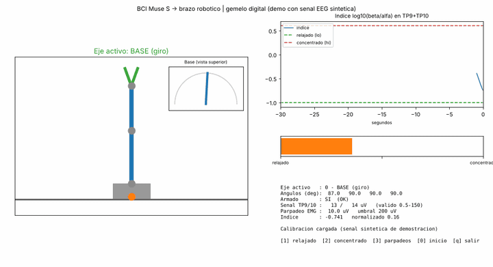

# BCI para controlar un brazo robótico como tecnología de asistencia

Prototipo de teleoperación con EEG, orientado a explorar una interfaz de asistencia para personas con movilidad reducida (por ejemplo, ELA). Se usa una diadema **Muse S**, la señal se procesa en Python y los comandos se envían por **UDP** a un **ESP32** que mueve un brazo de 3 ejes con pinza.



*Gemelo digital ejecutando el código real con EEG sintético (`demo_sintetica.py`).*

**Aporte del autor:** definición de arquitectura, máquina de estados, comportamiento esperado, límites de diseño y criterios de seguridad; la implementación de software se desarrolló con apoyo de herramientas de IA.

**Precaución:** prototipo experimental; no es un dispositivo médico ni está validado para uso clínico.

## Cómo funciona

| Función | Señal | Implementación |
|-|-|-|
| **Embrague** (cambiar eje activo) | Parpadeo voluntario (EMG en AF7/AF8) | Pasabanda 1–45 Hz + notch 50 Hz, envolvente con media móvil, umbral con histéresis y período refractario |
| **Acelerador** (ángulo del eje activo) | Índice `log10(beta/alfa)` en TP9/TP10 | Ventana de 2 s, normalizado con calibración personal (relajado / concentrado) y suavizado EMA |
| **Seguridad** (`armed = 0`) | Calidad de señal y acelerómetro | Señal plana o saturada, o movimiento de cabeza → desarma; el acelerador se congela tras cada parpadeo |

Protocolo UDP (texto, 20 Hz): `"<eje>,<ángulo 0-180>,<armed 0|1>\n"`, puerto 4210 por defecto.

## Archivos

- `src/main_bci.py`: lazo principal BCI → ESP32 (detección, índice, seguridad, calibración y envío UDP).
- `src/bci_gui.py`: interfaz en vivo con gemelo digital del brazo (vista lateral y superior), índice en tiempo real y estado de seguridad. El brazo simulado usa la misma velocidad máxima que el real (60 °/s).
- `src/demo_sintetica.py`: prueba la interfaz sin diadema ni ESP32. Reemplaza la Muse S por una señal EEG sintética (concentración que sube y baja, y parpadeos periódicos) y ejecuta el mismo procesamiento real.
- `src/prueba_senal_af7.py`: prueba inicial de conexión; graba 5 s y grafica la señal cruda del electrodo AF7.
- `pixi.toml` / `pixi.lock`: entorno reproducible (Python, NumPy, SciPy, Matplotlib, BrainFlow).

## Ejecutar

Requiere [pixi](https://pixi.sh). Todo menos `demo_sintetica.py` necesita una Muse S emparejada por Bluetooth.

```bash
pixi install
cd src
pixi run python main_bci.py --dry-run                 # sin ESP32, solo imprime
pixi run python main_bci.py --ip 192.168.1.50 --calibrate
pixi run python demo_sintetica.py                     # sin Muse ni ESP32: señal sintética
pixi run python bci_gui.py                            # gemelo digital, sin hardware de brazo
pixi run python bci_gui.py --ip 192.168.1.50          # gemelo digital + envío al ESP32
```

En `bci_gui.py`: `1` calibra relajado, `2` concentrado, `3` parpadeos, `0` lleva el brazo a la posición inicial, `q` sale. La calibración se guarda en `calib.json` (excluido del repositorio porque es personal).

## Pendiente

- Firmware del ESP32 del brazo (límites de velocidad y parada ante pérdida de comunicación).
- Fotos o video del prototipo funcionando.
